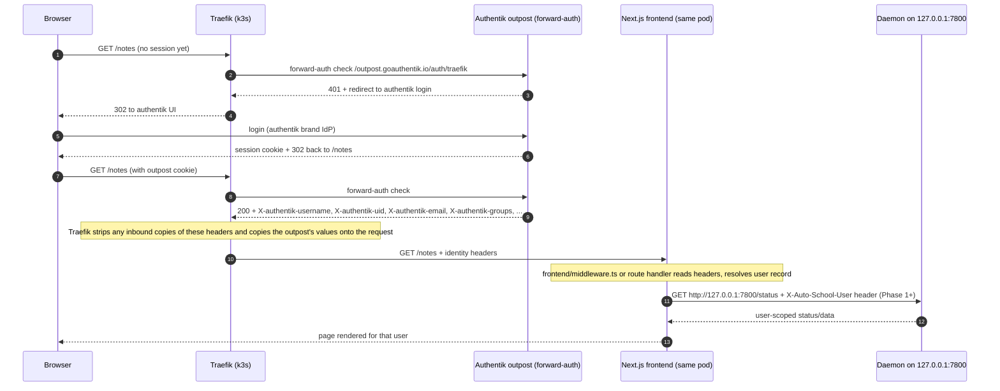

# Authentik federation — planning document

**Status:** planning only — no code changed. Branch `plan/postgres-migration`.
**Scope:** use Authentik as the IdP / user-account federation layer for a future multi-user
auto-school. Companion to the Postgres migration plan (user records will live there).
Later product goals (onboarding wizard, AI login-recipe builder, BYOK): see
`future-product-goals.md`.

---

## 1. Current state (verified in repo)

| Aspect | Reality today |
| --- | --- |
| Edge auth | Authentik **proxy provider in forward-auth mode** already fronts the app: `deploy/k8s/auto-school-ingress.yaml` routes `Host(school.vanderloch.com)` through the `authentik-forwardauth` middleware to service `auto-school:80`, and forwards `/outpost.goauthentik.io/*` to the `authentik-outpost` service. |
| App auth | **None.** No `middleware.ts`, no session library, no user concept anywhere in `frontend/src/`. Every authenticated authentik user that passes the provider's policy can reach all routes and all `/api/*`. |
| Identity in app | Zero. The closest thing is the Account button in `frontend/src/app/navbar.tsx:48` which links to `/settings` — today it's just app settings. |
| Backend | Node daemon (`src/daemon.ts`) serves `/status`, `/scan`, `/join`, `/leave`, `/pause`, `/auth/graph`, etc. on `127.0.0.1:7800`, same pod as the frontend. `src/status.ts` holds a single global `Settings` object and one in-memory status board. |
| Frontend→daemon | `frontend/src/app/api/*/route.ts` (backend, chat, checklists, courses, deadlines, ingest, mapping, media, models, notes, segments, session, settings, transcribe) all `fetch()` `BACKEND_URL ?? http://127.0.0.1:7800`. Some routes (media, courses, notes) bypass the daemon entirely and read the PVC filesystem via `frontend/src/lib/data.ts` (`DATA_DIR` = `AUTO_SCHOOL_DATA`). |
| Single-user assumptions | One Teams account (creds + `TOTP_SECRET` in the `auto-school-env` k8s Secret, see header comments of `deploy/k8s/auto-school.yaml`), one persistent Chromium profile (`user-data/`), one PulseAudio sink, one RWO Longhorn PVC (`auto-school-data`), `strategy: Recreate, replicas: 1` because of the Chromium profile lock. |

So: **authentication exists at the edge; identity is thrown away at the app boundary.** The plan is
to consume it, not to add a second login.

---

## 2. Recommended target architecture

**Primary approach: Option (a) — trust the forward-auth identity headers, read them in Next.js
server code. No Auth.js, no app-level OIDC.**

Rationale:

1. Authentik already runs as the auth choke point; the outpost is the only thing that can set
   `X-authentik-*` on requests that survive Traefik (see §4 spoofing analysis).
2. Next.js App Router makes header consumption trivial in RSCs, route handlers, and
   `middleware.ts` — and *all* frontend data access already flows through server-side route
   handlers that proxy to the daemon. There is no meaningful client-side session requirement
   today (no third-party API clients, no mobile app).
3. Zero interplay risk: no second cookie, no double login, no logout-redirect loops, no
   `NEXTAUTH_URL`-behind-reverse-proxy problems.

**When the alternatives win (defer, revisit triggers included):**

- **Option (b) — Auth.js v5 + Authentik OIDC provider.** Choose later *if* we need rich
  client-side session awareness (e.g. an SPA-heavy page calling daemon APIs directly from the
  browser with CSRF protection), native mobile/desktop clients, or the daemon ever becomes
  network-reachable beyond loopback. Known pitfalls if stacked on forward-auth: two parallel
  sessions that desynchronize (forward-auth cookie vs Auth.js cookie), double login prompts,
  logout loops (logging out of Auth.js does not log out the outpost session and vice versa;
  each must call the other's end-session URL), and `X-Forwarded-*`/redirect-URI misderivation
  behind Traefik. If ever adopted, pick **one** of the two mechanisms as authoritative and make
  the other sessionless.
- **Option (c) — signed service token frontend→daemon.** Today frontend and daemon are
  same-pod/loopback (`127.0.0.1:7800`, not exposed by any Service except through the Next.js
  container), so the network boundary *is* the auth boundary. A signed header (HMAC or the
  outpost's `X-authentik-jwt`) becomes necessary only if the daemon is ever split into its own
  pod/Service. Plan the seam, don't build it yet.

### Auth flow (target, Phase 0–1)



### Logout flow

```mermaid
sequenceDiagram
    autonumber
    participant U as Browser
    participant T as Traefik
    participant AO as Authentik outpost
    participant DA as Daemon (recording in progress)

    U->>T: GET /outpost.goauthentik.io/signout?rd=/
    T->>AO: signout request
    AO-->>U: session cookie cleared, 302 to /
    U->>T: GET /
    T->>AO: forward-auth check
    AO-->>T: 401 (not authenticated)
    T-->>U: redirect to login
    Note over DA: web session expiry/logout never touches the daemon. An in-flight recording, scan schedule, or join window keeps running server-side; only the UI watch-stream is interrupted until re-login.
```

---

## 3. Option comparison (summary)

| | (a) trust forward-auth headers | (b) Auth.js + OIDC | (c) signed header to daemon |
| --- | --- | --- | --- |
| Code added in repo | ~1 lib + middleware | Auth.js config, provider, session strategy, dual-logout handling | HMAC/JWT mint + verify in daemon |
| Login UX | single authentik login (already live) | potentially two logins unless carefully stacked | n/a (transport auth, not user auth) |
| Session storage | none (stateless per request) | DB/JWT sessions | n/a |
| CSRF surface | none new (server-side reads only) | must configure for /api routes | must verify signature + issuer |
| Fits current topology | **yes — loopback daemon, no external clients** | only when clients bypass Next.js | only when daemon leaves the pod |
| Verdict | **primary** | fallback (triggers listed in §2) | Phase-2 seam only |

---

## 4. Header contract

The outpost answers Traefik's forward-auth check with 200 + identity headers. Traefik's
`forwardAuth` middleware must copy them onto the proxied request via `authResponseHeaders`
(official authentik Traefik template lists exactly these; `authResponseHeadersRegex: "^X-authentik.*"`
also works on Traefik v3 and auto-covers future headers).

**Traefik middleware (lives in the authentik namespace, alongside the outpost — not in this
repo; verify before Phase 0):**

```yaml
apiVersion: traefik.io/v1alpha1
kind: Middleware
metadata:
  name: authentik-forwardauth
  namespace: authentik   # wherever the outpost service lives
spec:
  forwardAuth:
    # cluster-internal outpost service endpoint, not the public ingress
    address: http://authentik-outpost-<slug>:9000/outpost.goauthentik.io/auth/traefik
    trustForwardHeader: true
    authResponseHeadersRegex: "^X-authentik.*"
```

> `trustForwardHeader: true` also makes Traefik forward `X-Forwarded-*` (Host, Proto, Uri) to the
> outpost so redirects stay on `https://school.vanderloch.com`.

**Headers the app should read:**

| Header | Meaning | App use |
| --- | --- | --- |
| `X-authentik-uid` | authentik user pk (stable per user) | **primary key for user records** |
| `X-authentik-username` | `preferred_username` (mutable handle) | display name, folder names, logs |
| `X-authentik-email` | user email | contact, gravatar, notifications |
| `X-authentik-name` | full name | UI label |
| `X-authentik-groups` | comma-separated group names | role model (§7) |
| `X-authentik-entitlements` | entitlement strings from property mappings | future fine-grained perms |
| `X-authentik-jwt` | signed JWT for this request's user (JWKS url in `X-authentik-meta-jwks`) | optional cryptographic verification (Phase 2+/defense in depth) |
| `X-authentik-meta-provider`, `X-authentik-meta-app`, `X-authentik-meta-outpost`, `X-authentik-meta-version`, `X-authentik-meta-jwks` | which provider/app/outpost authenticated the request | debugging / multi-provider guard |

Rules:

1. **Never trust these headers from any path other than through Traefik.** Next.js should only
   read them when it knows it is behind the edge. Gate with an env flag
   (`TRUST_AUTHENTIK_HEADERS=1` set in `deploy/k8s/auto-school.yaml`) so local dev (no Traefik)
   and `next start` outside k8s can't be spoofed.
2. Traefik's `authResponseHeaders`/Regex handling **removes any inbound client-supplied copies**
   of those headers before copying the outpost's values — that is the anti-spoofing mechanism.
   Keep the regex form so newly added authentik headers are covered automatically. Belt-and-braces:
   `frontend/src/middleware.ts` can additionally reject/strip `X-authentik-*` on requests that
   arrive without the internal marker (see §9).
3. Custom headers (if ever needed, e.g. percent-encoded name): set via authentik
   user/group attribute `additionalHeaders` or a proxy scope mapping returning
   `{"ak_proxy": {"user_attributes": {"additionalHeaders": {...}}}}` — docs: "Custom headers"
   (proxy provider). Static group attributes and dynamic scope mappings can be combined; the
   mapping wins on conflicts.

---

## 5. Per-user data mapping

**Identity mapping**

- `users` table (Postgres — see the migration plan): `id` (PK), `authentik_uid` (unique,
  `X-authentik-uid`), `username` (unique, display/handle), `email`, `display_name`,
  `role` derived from groups (§7), `created_at`, `last_seen_at`.
- First request with an unknown uid → auto-provision row (JIT). Username rename in authentik
  ≠ new user because uid is the key. Social SSO sources (Google/Microsoft/Discord/GitHub —
  all built into Authentik) need NO schema change: each links to one Authentik account with
  one uid; match sources by verified email so a human can't end up with two uids (details in
  `future-product-goals.md` §D).
- **Claiming existing data:** the entire pre-migration dataset (all recordings, notes, courses,
  mappings, deadlines) belongs to the authentik account **`lochis`** — the single existing
  user. The Postgres migration plan seeds a `lochis` user row (fixed UUID `…0001`, every
  imported row owned by it, `authentik_sub = NULL`). First login where
  `X-authentik-username == 'lochis'` (or an explicit one-time admin claim action) sets
  `authentik_sub` on that seed row — do **not** JIT-provision a *new* user for that first login;
  the claim step must run before JIT (match by username, merge if both exist).
- Optional strictness: parse `X-authentik-jwt` and require `sub == uid` before trusting plain
  headers (only worth it once a verification lib exists; the loopback topology already limits
  exposure).

**School credentials (Teams email/password/TOTP)** — authentik does **not** hold these; the app
must collect and store them per user. High-level options:

| Option | Notes |
| --- | --- |
| Per-user k8s Secret (`auto-school-creds-<uid>`) | KMS-at-rest via the cluster's encryption config; mounting/env-injection is awkward for N users and requires the daemon to read the API — fine for small N. |
| SOPS-encrypted files on the PVC | Git-auditable, but rotation means re-encrypt per user; decryption key must live in the pod anyway. |
| **Encrypted blob per user in Postgres (recommended)** | `user_credentials` table: AEAD-encrypted (e.g. libsodium `crypto_secretbox`/AES-GCM) with a single master key from the `auto-school-env` Secret (`CREDENTIALS_MASTER_KEY`), never in plaintext columns; TOTP secret stored the same way. Rotation = update one master-key-encrypted row from the settings UI. |

Collection flow (Phase 2): `/settings` gains a credentials form; server route writes the
encrypted blob; daemon decrypts at join time only, in memory. Never log plaintext; redact in
status events (`src/status.ts` board messages).

**Filesystem partitioning** (what is today global becomes per-user under `DATA_DIR`):
`recordings/<user>/`, `notes/<user>/`, `user-data/<user>/` (Chromium profile),
`user-data/<user>/deadlines.json`, `mapping.json` → per-user or keyed. Touchpoints:
`frontend/src/lib/data.ts` (path root per user), `src/paths.ts` (`DATA_DIR`/`OUT_DIR` per user),
`src/pipeline/*` call sites.

---

## 6. Session & logout semantics for long-running recordings

- The only session is the **authentik outpost cookie** for `school.vanderloch.com`
  (plus authentik's own IdP session). Its lifetime is governed by the proxy provider's
  *Session duration* / authentik policies — not by anything in this repo.
- Logout = send the user to `/outpost.goauthentik.io/signout` (the outpost path already routed
  by the IngressRoute). No app-level session to clear until/unless Auth.js is added.
- **Recording jobs must NOT be tied to the web session.** The daemon's scan/join/record/consolidate
  pipeline is server-side state (`src/status.ts` board, scheduled join windows). If a user's
  session expires mid-lecture: UI polling stops, daemon keeps recording, consolidation +
  transcription continue, user re-authenticates and sees the session again. Keep it this way —
  do not add session-lifetime checks to daemon jobs.
- One nuance for Phase 2: a *credential* problem (expired Teams password) is a job-level failure,
  handled by the existing status board + a "re-enter credentials" prompt on next login. Distinct
  from web-session expiry.

---

## 7. Roles via authentik groups/entitlements (brief)

- Map `X-authentik-groups` → roles: e.g. group `auto-school-admins` → admin (settings, join/leave,
  delete sessions, manage users' credentials), everyone else in the provider's access policy →
  member (read own recordings/notes, control own recorder).
- Enforcement point: `frontend/src/lib/auth.ts` helper returns `{ uid, username, role }`; route
  handlers gate destructive verbs (the POST bodies in `frontend/src/app/api/backend/route.ts`
  already centralize join/leave/reset — those become admin/self checks).
- `X-authentik-entitlements` can carry finer grants later (e.g. per-course access) via property
  mappings without schema change.
- Access policy at the authentik provider itself remains the outer gate (who may reach the app
  at all).

---

## 8. Phased rollout

### Phase 0 — see the user (no behavior change)
- Verify/extend the `authentik-forwardauth` middleware in the authentik namespace to forward
  all `X-authentik-*` headers (regex form, §4).
- New `frontend/src/lib/auth.ts`: `getAuthentikUser(headers)` → null when
  `TRUST_AUTHENTIK_HEADERS` unset. New `frontend/src/middleware.ts`: strip `X-authentik-*`/
  `X-Auto-School-*` unless the trusted flag is set (defense against direct-pod access).
- UI: navbar Account button (`frontend/src/app/navbar.tsx:48`) and `/settings` page show
  username/email/groups from headers.
- Set `TRUST_AUTHENTIK_HEADERS=1` in `deploy/k8s/auto-school.yaml` (secret/env section).
- Acceptance: logged-in identity visible; curl direct to pod port-forward shows stripped headers.

### Phase 1 — per-user data keys (single daemon still)
- Postgres `users` table (ties into the migration plan) + JIT provisioning in
  `frontend/src/lib/auth.ts`. Order matters: seed `lochis` claim (above) runs first, so the
  existing dataset attaches to the real account instead of a fresh JIT row.
- Thread user through the proxy layer: every `frontend/src/app/api/*/route.ts` resolves the user
  and sends `X-Auto-School-User: <uid>` to the daemon; daemon (`src/daemon.ts`, `src/paths.ts`,
  `src/status.ts`) partitions `DATA_DIR` reads/writes and `Settings` by uid. Filesystem layout
  per §5.
- Acceptance: two authentik test users see disjoint recordings/notes/settings.

### Phase 2 — full federation (multi-recorder)
- Per-user school credentials capture + encrypted storage (§5), per-user Chromium profile and
  PulseAudio sink per recording session; likely one daemon/container-set per active user
  (StatefulSet or per-user Deployments) instead of one shared pod — the RWO PVC + profile lock
  (`deploy/k8s/auto-school.yaml` top comments) forbid naive concurrency. Frontend becomes the
  only fixed component + a per-user daemon registry.
- Optional: verify `X-authentik-jwt` signature against `X-authentik-meta-jwks` before trusting
  headers; revisit Auth.js/signed-transport decisions if the topology splits (§2 triggers).

---

## 9. Open questions / risks

1. **Header spoofing** — mitigated by: Traefik `authResponseHeadersRegex` strips/overwrites
   inbound `X-authentik-*`; the app only honors them when `TRUST_AUTHENTIK_HEADERS=1`; the pod's
   7800 port is never exposed beyond loopback; Phase 0 middleware strips inbound copies as
   belt-and-braces. Residual: anyone who can reach the Next.js container bypassing Traefik
   (port-forward, debug `kubectl port-forward` habit noted in `deploy/k8s/auto-school.yaml`)
   could forge `X-Auto-School-User` *to the daemon* — acceptable while same-pod; close with an
   HMAC on that internal header if topology ever splits.
2. **Middleware ownership** — `authentik-forwardauth` lives outside this repo (authentik
   namespace). Confirm it forwards the full header set; if it was created with the legacy
   explicit list, entitlements/jwt headers may be missing today.
3. **Header size** — large group lists or long usernames can exceed Traefik/Next.js header
   buffers; keep group count small (roles, not per-course grants, in groups).
4. **Concurrency wall** — Phase 2's real cost is Chromium/PulseAudio/PVC fan-out, not auth.
   Decide per-user-pod vs. serialized recording queues early; auth design above is agnostic.
5. **Username renames** — key everything on uid; audit UI copy that displays usernames in paths
   (recording folders use course/session stems, not usernames, today — keep it that way).
6. **Auth.js fallback cost** — if ever adopted, pick one authoritative session and wire the
   other side's logout (`/outpost.goauthentik.io/signout` + Auth.js `signOut()`) or loops
   will bite (documented pitfall of stacking forward-auth + app OIDC).
7. **Outpost availability** — forward-auth means the outpost is on the critical path for every
   request; its unavailability = app down (not open). Acceptable; worth a probe/alert.
