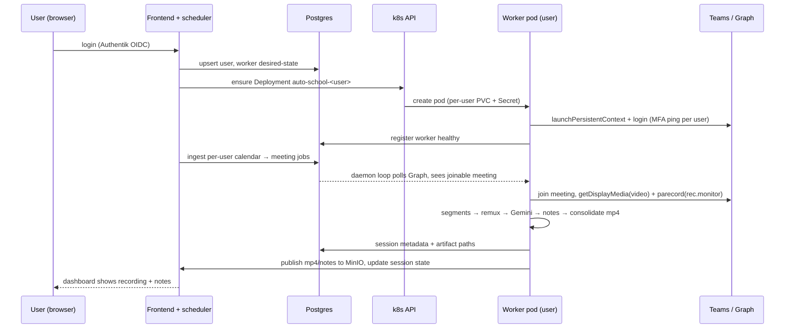

# Multi-User Architecture — auto-school

Status: **HISTORICAL (2026-10-20)** — the pod-per-user scale-out designed here was killed by
the hosted-platform pivot (daemon is personal-only; commercial multi-user is a hosted web app
fed by an Electron client — see `hosted-platform.md`). Kept as reference for the concurrency
verdicts (RWO PVC, profile locks) which still govern the personal pod. Branch: `plan/postgres-migration`.
Companion doc: `docs/planning/authentik-federation.md` (identity, per-user auth, secrets — not duplicated here).

## Executive summary

**Q1 — Can one pod record multiple pages (video + audio) simultaneously with this backend?**
**No — not as built, and audio is the reason.** Video multi-capture is feasible (one `getDisplayMedia({preferCurrentTab})` per tab is allowed in one Chromium), but audio *cannot* be isolated per tab: the recorder takes audio not from the browser but from a **single PulseAudio null-sink monitor** (`rec`) that mixes the whole pod's sound (`src/record/recorder.ts:34,67–76`, `deploy/entrypoint.sh:23–30`). The entrypoint's own comment records that Chromium's tab-audio path "ignores routing overrides (verified the hard way)" — i.e. the standard per-stream re-routing trick (`pacmd move-sink-input`) was already tried and is dead in this environment. Layered on top: the persistent-profile lock means one Chromium = one school identity (`src/daemon.ts:4`, `src/login/teams-login.ts:65–88`).

**Q2 — Is one daemon pod per user the right scale-out model?**
**Yes.** The pod *is* the isolation unit for everything hard here: browser profile (identity), PulseAudio server (audio isolation), Xvfb display, /dev/shm, recordings scratch space. Scale = N pods, one per user, provisioned by a control plane; identity comes from Authentik; metadata goes to Postgres (companion doc); per-user PVC holds profile + recordings (later offloaded to object storage). This is exactly the pattern commercial browser-infrastructure and meeting-bot vendors converged on (Browserbase, Browserless, Recall.ai — see §4).

---

## 1. Concurrency analysis (with code evidence)

### 1.1 Video — feasible, with a caveat

`startRecording()` injects a per-tab capture via `page.evaluate` — `getDisplayMedia({ preferCurrentTab: true, displaySurface: "browser", audio: false })` (`src/record/recorder.ts:146–172`). Chromium does allow multiple simultaneous tab captures in one browser instance, and each `MediaRecorder` + base64 `__seg` IPC pipe (`recorder.ts:100–140`) is already keyed by page. So N tabs → N isolated video streams is technically possible in one Chromium.

Caveats: every capture runs a `MediaRecorder` VP8/VP9 encode *inside the same browser process group* (CPU contention), the pod's 1 Gi `/dev/shm` and 4-CPU limit are sized for **one** recording (the manifest comment notes cgroup throttling already "choppy'd audio in 42% of periods" at 2 CPUs — `deploy/k8s/auto-school.yaml`, resources block), and the recorder writes all segments into one flat `SEGMENTS_DIR` with title-derived stems (no per-user/per-recording namespace) plus a module-level `liveStem` singleton (`recorder.ts:36–38`) that would collide across concurrent recordings.

### 1.2 Audio — the killer (why the sink exists at all)

The recorder's own comments state it precisely:

- `recorder.ts:67`: *"Edge/Linux getDisplayMedia audio is a FAKE TONE in this environment (verified) — real audio comes from tapping the browser's PulseAudio sink monitor directly."*
- `recorder.ts:166–168`: the capture is `audio: false` because the track is a fake tone; audio comes from `parecord`.
- `recorder.ts:73`: `spawn("parecord", ["--file-format=ogg", "-d", \`${REC_SINK}.monitor\`, audioFile])` — **one** parecord on **one** sink monitor for the whole session; the resulting single `.ogg` is muxed into every segment and the final mp4 during consolidation.
- `entrypoint.sh:23–30`: exactly **ONE** `module-null-sink sink_name=rec`, made the default sink and source. The comment: *"ONE sink, full stop. Edge/Linux tab-audio capture grabs a monitor source and ignores routing overrides (verified the hard way) — so isolation = there is nothing else to hear."* Any other audio-playing process in the pod would leak into the recording; the isolation strategy is *silence*, not routing.

So a sink monitor is the **system-wide mix**. Two recordings in one pod ⇒ both `parecord` instances capture the *same mixed audio* of both meetings — crosstalk, not isolation.

### 1.3 Could per-tab audio routing be fixed inside one pod?

| Approach | Verdict |
|---|---|
| **N sinks + `pacmd move-sink-input` per Chromium stream** | **Dead in this environment.** Requires re-routing each sink-input to its sink; the codebase already verified Chromium's capture path ignores routing overrides (`entrypoint.sh:23–25`). Also inherently racy: sink-inputs must be moved after they appear, and any new tab/audio element re-registers on the default sink. |
| **PipeWire per-recording null sinks + loopback + stream-matching rules** | Theoretical fix: `module-null-sink` per recording, route by stream properties (`application.name`), capture each monitor. But all Chromium streams share the same `application.name`, tabs are indistinguishable at the Pulse/PipeWire layer, and the same "ignores routing overrides" behavior applies to how Chromium binds its capture. Fragile, undocumented-in-Chromium behavior, per-tab granularity simply isn't exposed. |
| **In-page WebRTC/AudioContext capture** | Would be the clean path (tab-scoped by construction) but is exactly what's broken: getDisplayMedia audio is a **fake tone** on Edge/Linux here (`recorder.ts:67,166–168`). Capturing remote audio via WebRTC internals is not a supported automation surface. |
| **One PulseAudio server per browser** (each Chromium started with its own `PULSE_SERVER`, own null sink + monitor) | **The only real in-pod isolation hack that works** — and the codebase half-supports it already: `teams-login.ts:69` passes `PULSE_SINK`/`PULSE_SOURCE` env into the browser, and `entrypoint.sh` suggests `PULSE_SERVER=...` for "throwaway" audio servers (`deploy/test-audio-crosstalk.cjs` tests this). But this means N Chromium instances with N profiles in one pod ⇒ you've reinvented "pod per user" with none of the k8s benefits (resource limits, restart isolation, scheduling, blast radius) and all of the operational pain (PID1 supervising N browsers, shared /dev/shm, shared CPU cgroup). |

### 1.4 Identity: one profile = one school account

- `src/daemon.ts:4`: *"One meeting at a time (persistent-profile lock: only one Chromium may touch user-data)."* The daemon holds a singleton `active: { page, title }` (`daemon.ts:67`) and calls `closeBrowser()` to release the profile.
- `src/meetings/browser.ts` caches exactly one persistent context for the pod's lifetime.
- `teams-login.ts:65–88` launches `chromium.launchPersistentContext(profileDir, …)` against a single `config.userDataDir` — one school identity, with a bespoke MFA Discord-ping flow. Two different users cannot share this profile (cookies, SSO sessions, Teams tenant state collide); Chromium additionally enforces the singleton lock on a user-data dir.

**Nuance:** two *simultaneous meetings of the same account* could share one profile in principle (Teams allows multi-tab), but they hit the audio-mix wall above, and the daemon's `buildBusy`/`active` singletons (`daemon.ts`) serialize everything anyway.

### 1.5 Q1 verdict (precise)

- **Video, multiple tabs, one Chromium: possible** (multiple getDisplayMedia tab captures), at ~1 encode-CPU per extra capture.
- **Audio, per-tab isolation, one pod: impossible as built** (single sink monitor = system mix) **and not practically fixable**: the two standard mechanisms (per-stream sink routing; getDisplayMedia tab-audio) are respectively *verified-broken* and *fake-tone* in this environment. The least-bad single-pod option — one PulseAudio server per Chromium — still requires one Chromium per user, which is a pod-per-user model implemented badly.
- **Two users, one browser: impossible** (persistent-profile lock, single identity, `daemon.ts:4`).

Therefore: **clean multi-user recording requires one audio domain and one browser profile per user ⇒ one pod per user.**

---

## 2. Why pod-per-user is the right primitive

Everything the system needs to isolate maps 1:1 onto a pod boundary:

| Resource | Today (single pod) | Per-user pod |
|---|---|---|
| Browser profile (identity, SSO, MFA state) | one PVC dir, singleton lock | per-user PVC, no contention |
| Audio | one PulseAudio + one sink (`entrypoint.sh`) | one PulseAudio + one sink per pod — **zero code change** to the recorder/entrypoint |
| Display | one Xvfb `:99` | one Xvfb per pod |
| CPU/RAM bursts (Chromium encode + ffmpeg remux + Gemini batching) | shared 4-CPU cgroup; throttling already degraded audio once | isolated requests/limits; one user's burst can't chop another's audio |
| Recordings/notes scratch | flat shared dirs | per-user PVC namespace |
| Crash/restart blast radius | all-or-nothing (`strategy: Recreate`, replicas 1) | exactly one user |
| Secrets (Teams creds, TOTP, Gemini key) | one k8s Secret | per-user Secret (see Authentik doc) |

The recorder, entrypoint, and login flow are **already single-user-per-process by design** — the pod boundary is the smallest change that makes that design correct for N users.

---

## 3. How the world handles this (precedents)

- **Browserbase** — session = "a single browser instance running in the cloud… an isolated environment"; *Contexts* persist user data (cookies, storage) across sessions and are the unit of tenant identity (docs.browserbase.com/platform/browser — "Contexts", "Create a browser session"). This is our per-user PVC + ephemeral worker, productized.
- **Browserless (BaaS)** — managed browsers behind a WebSocket/CDP endpoint; self-hostable on k8s via Helm chart with `CONCURRENT`/`QUEUED` session caps (docs.browserless.io; icoretech/helm browserless chart). Their scaling writeup frames 1,000+ concurrent browsers as a lifecycle/resource-management problem — i.e. pool of isolated browser workers, not one browser with many tabs.
- **Recall.ai / meeting bots** — the reference Teams bot sample uses a **two-service split: control plane (lifecycle mgmt, data aggregation) vs execution plane (browser automation + capture)** in separate containers (deepwiki.com/recallai/microsoft-teams-meeting-bot — "System Architecture"). Recall.ai's product runs "thousands of concurrent" bots, each one isolated browser context per meeting. Same control/execution split proposed below.

Common pattern across all three: **one isolated browser environment per session/tenant, orchestrated by a stateless control plane.** Nothing production-grade tries multi-tenant capture inside a single browser.

---

## 4. Options

| | A. Single pod, N browsers + N PulseAudio servers | **B. Pod-per-user workers (recommended)** | C. External bot API (Recall.ai etc.) |
|---|---|---|---|
| Audio isolation | Yes (hack) | Yes (clean, unchanged code) | Yes (vendor) |
| Identity isolation | N profiles in one image — singleton locks, `liveStem`, flat dirs all need rework | Per-user PVC; daemon unchanged (`USER_DATA_DIR`, `DATA_DIR` already env-driven) | Vendor-hosted (school creds leave the cluster ✗) |
| Failure blast radius | Whole pod | One user | Vendor SLA |
| Resource control | Shared cgroup — one user's encode throttles another's audio (known failure mode) | Per-pod requests/limits | N/A (vendor cost) |
| k8s-native scheduling/autoscale | No | Yes (StatefulSet / per-user Deployments) | N/A |
| Code change | Large, fragile | Medium (control plane + env plumbing) | Large (rewrite capture path), recurring $$, school-privacy risk |
| Verdict | Rejected | **Target** | Rejected (data leaves homelab; ToS) |

---

## 5. Recommended target architecture

**Control plane (stateless):** today's Next.js frontend + a new scheduler service. Authentik OIDC authenticates users (see `docs/planning/authentik-federation.md`); Postgres holds users, workers registry, meeting jobs, session metadata (schema in companion doc). The scheduler reconciles *desired workers* from the user table — creating/healthy/deleting per-user worker Deployments (or a StatefulSet with per-ordinal PVCs) via the k8s API.

**Data plane (per-user worker pods):** the existing daemon image, unchanged in its core (entrypoint Xvfb/Pulse/sink, `teams-login`, recorder). It gains: `AS_USER` env, per-user Secret injection, per-user PVC (`profile` + `recordings`/`notes`), and registration with the control plane on boot. Frontend API routes stop hitting `localhost:7800` and instead proxy to `http://auto-school-<user>.workers.svc:7800` selected by the authenticated session (today's coupling exists only because the PVC is RWO and the frontend shares the pod — `deploy/k8s/auto-school.yaml` header comment; the frontend reads files directly via `AUTO_SCHOOL_DATA`, which moves behind the worker's own HTTP surface or an object-store URL).

**Jobs/scheduling:** per-user calendar ingestion (per-user Graph device-code tokens, one-time, MFA-pinged via that user's notification channel) → meeting jobs in Postgres → the owning worker's daemon loop (it already polls Graph + joins + records). Control plane handles worker lifecycle and scale-to-zero between class blocks; workers warm up ~10 min before first meeting (login/session-reuse is the slow path: cold login 30–60 s + MFA push, `teams-login.ts`).

**Storage evolution:** per-user Longhorn PVC (RWO is fine — exactly one worker mounts it) for profile + live scratch; after consolidation, publish artifacts to MinIO/S3 and keep only metadata + paths in Postgres (companion doc). This keeps PVCs small (browser profile ≪ recordings) and decouples retention from pod lifetime.

### 5.1 Topology

```mermaid
flowchart TB
    U1["Student 1"] --> TR["Traefik ingress (TLS)"]
    U2["Student 2"] --> TR
    TR --> AUTH["Authentik OIDC (auth proxy)"]
    AUTH --> FE["Frontend + scheduler<br/>(stateless control plane)"]
    FE --> PG[("Postgres<br/>users · jobs · session metadata")]
    FE --> W1["Worker pod user-1<br/>Xvfb · PulseAudio+sink · Chromium(profile-1)<br/>recorder · ffmpeg · Gemini"]
    FE --> W2["Worker pod user-2<br/>Xvfb · PulseAudio+sink · Chromium(profile-2)<br/>recorder · ffmpeg · Gemini"]
    W1 --> PVC1[("PVC user-1<br/>profile · recordings")]
    W2 --> PVC2[("PVC user-2<br/>profile · recordings")]
    W1 --> OBJ[("MinIO / S3<br/>published artifacts")]
    W2 --> OBJ
    W1 --> EXT["Teams / Graph / Discord notify"]
    W2 --> EXT
```

### 5.2 Lifecycle sequence

(Both diagrams are standard mermaid `flowchart`/`sequenceDiagram`; validated syntax, no HTML labels — draw.io imports them directly.)

---

## 6. Resource sizing (per concurrent user)

Current single-user pod is the ground truth: requests 500m/1Gi, **limits 4 CPU / 4 Gi** (raised from 2 CPU because throttling "choppy'd audio in 42% of periods"), `/dev/shm` 1 Gi Memory emptyDir (`deploy/k8s/auto-school.yaml`).

| Component | Idle | Recording peak |
|---|---|---|
| Xvfb | ~20 MB | ~30 MB |
| PulseAudio + parecord | ~10 MB | ~30 MB |
| Chromium (headful, 1 meeting tab + capture) | ~600 MB | ~1.5 Gi |
| MediaRecorder encode + ffmpeg remux bursts | — | +1.5–2 CPU, ~500 MB |
| Node daemon + Gemini batching | ~150 MB | ~300 MB |

Planning numbers: **requests ≈ 500m/1.5Gi, limits ≈ 3–4 CPU / 4Gi per user-pod**; i.e. a 16-core/32-Gi node comfortably runs ~4 simultaneous recordings (peaks are staggered by class schedules). Idle workers (logged in, no meeting) are cheap — but with scale-to-zero between blocks, keep at most one warm window per school day. Node cost is the dominant scaling factor; this is exactly why vendors charge per concurrent session.

---

## 7. Phased migration

1. **Phase 0 — today:** single pod, daemon+frontend co-located, RWO PVC, basicAuth ingress. Works for exactly 1 user.
2. **Phase 1 — control plane substrate (Postgres branch):** land Postgres schema (companion doc), move session/course metadata behind it. Split frontend out of the daemon pod; frontend→daemon via Service instead of localhost (keep 1 user, no behavior change).
3. **Phase 2 — worker extraction:** parametrize the daemon by `AS_USER`/`DATA_DIR`/`USER_DATA_DIR` (already env-driven: `src/config.ts:14`), build the worker Deployment template + per-user PVC/Secret controller (small reconciler, not full operators). Migrate the existing user onto `auto-school-lochis`. Delete the co-located manifest.
4. **Phase 3 — auth + onboarding:** Authentik federation (companion doc), per-user Graph device-code flow, per-user Discord notify webhook, secrets per user (ExternalSecret/SOPS or per-user k8s Secret).
5. **Phase 4 — scheduling + scale-to-zero:** calendar-driven warm-up windows, worker hibernation between blocks, job queue in Postgres, worker health/self-heal (entrypoint already clears stale Xvfb/Pulse/Singleton locks).
6. **Phase 5 — storage offload:** consolidate → MinIO/S3, PVC shrinks to profile + scratch, retention enforced at the object store; Postgres is the source of truth for listings.

## 8. Risks / open questions

- **MFA interactivity at scale:** each user's first login needs an MFA push *to that user* — per-user notification channels are mandatory (today's single Discord webhook is baked into `notify.ts`). Open: email/Matrix fallback per user?
- **Per-user credential storage:** school passwords + TOTP secrets in k8s Secrets is fine at N≈5, questionable beyond. Companion doc owns this.
- **Cold starts:** session reuse via PVC usually avoids MFA, but a tenant-wide password rotation re-triggers N interactive logins; schedule-aware warm-up needed.
- **Node capacity:** ~4 concurrent recordings per 16-core node; k3s single-node today — multi-user means multi-node Longhorn or capping concurrency.
- **School ToS / detectability:** N bot participants joining the same classes is more visible than one; one-bot-per-user actually helps (each bot joins only its owner's classes).
- **Gemini quota/cost:** per-user API keys or a shared budget with per-user rate limits (status.ts quota tracking is process-local today).
- **Flat shared dirs:** recorder/notes assume one namespace per pod — already solved by pod isolation, but any future *multi-meeting-per-pod* work must revisit `liveStem`, `SEGMENTS_DIR` layout, and the sink comment's "nothing else to hear" invariant.
